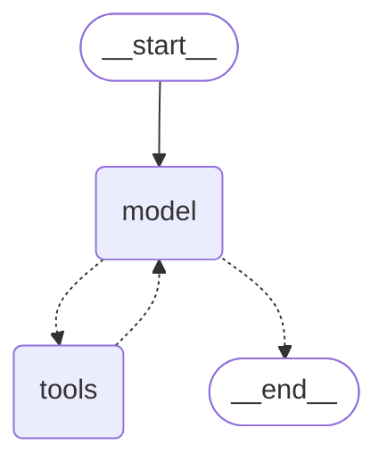

# 第 1 章 · 一次 invoke 的真相

> 本章目标：**让 `create_agent` 把它内部那张图打印出来**，然后你亲眼看懂"Agent 循环"只是一个 `model ↔ tools` 的状态机。预计 60 分钟。

---

## ① 本章你会得到什么

1. 能画出 `create_agent` 编出的图：**节点叫什么、边怎么连、哪里退出**
2. 能解释"为什么没工具就没有循环"
3. 能说清 `recursion_limit = 9999` 是谁设的、为什么
4. 手里有一个能反复用的 `dump_messages()`，后面 10 章都靠它观察

---

## ② 源码解剖：`create_agent` 到底编了张什么图

文件：`libs/langchain_v1/langchain/agents/factory.py`

### 2.1 签名与十六个参数

```python
def create_agent(
    model: str | BaseChatModel,
    tools: Sequence[BaseTool | Callable[..., Any] | dict[str, Any]] | None = None,
    *,
    system_prompt: str | SystemMessage | None = None,
    middleware: Sequence[AgentMiddleware[StateT_co, ContextT]] = (),
    response_format: ResponseFormat[ResponseT] | type[ResponseT] | dict[str, Any] | None = None,
    state_schema: type[AgentState[ResponseT]] | None = None,
    context_schema: type[ContextT] | None = None,
    checkpointer: Checkpointer | None = None,
    store: BaseStore | None = None,
    interrupt_before: list[str] | None = None,
    interrupt_after: list[str] | None = None,
    debug: bool = False,
    name: str | None = None,
    cache: BaseCache[Any] | None = None,
    transformers: Sequence[TransformerFactory] | None = None,
) -> CompiledStateGraph[...]:
```

文档字符串第一句（原话）：

> **"Creates an agent graph that calls tools in a loop until a stopping condition is met."**

注意用词：**creates an agent graph**。它返回的不是"一个 Agent 对象"，而是一张**编译好的图**（`CompiledStateGraph`）。这意味着它跟你在 `langgraph_learn/` 里手写的东西是**同一个物种**。

再看 `tools` 参数的文档：

> "If `None` or an empty list, the agent will consist of **a model node without a tool calling loop**."

**这句话是本章的钥匙**——没有工具就没有循环。稍后实验 A 会验证。

#### 十六个参数逐个说清

先给一个能省掉你一半困惑的划分：**16 个参数里只有 7 个真正参与"建图"**（`model`、`tools`、`system_prompt`、`middleware`、`response_format`、`state_schema`、`context_schema`），其余 8 个是**一次性透传给 `graph.compile()`** 的运行配置。`name` 特殊，两边都沾。所以"改图的结构"和"改图的运行配置"是两件事。

下表引用的代码片段来自 master 分支 `libs/langchain_v1/langchain/agents/factory.py` 里 `create_agent` 的实现体（docstring 之后那一段）。行号会随版本漂移，所以我引片段、不引行号；你按片段去搜一定能搜到。

| 参数 | 默认 | 源码里它到底做了什么 | 你什么时候需要它 |
|---|---|---|---|
| `model` | 无（必填，位置参） | `if isinstance(model, str): model = init_chat_model(model)`。**这里不做任何 `bind_tools`**——工具是每次调用时才在 `_get_bound_model(request)` 里绑上去的 | 永远要。**坑**：传字符串时 api_key/base_url 只能靠 `init_chat_model` 认识的环境变量；你 `.env` 里的 `LLM_*` 它不认识，所以本书一律传 `BaseChatModel` 实例 |
| `tools` | `None` | `None → []`；按 `isinstance(t, dict)` 拆成 `built_in_tools`（交给 provider 执行，不在本地跑）和 `regular_tools`；`available_tools = middleware_tools + regular_tools`，有它才建 `ToolNode`；最后 `default_tools = list(tool_node.tools_by_name.values()) + built_in_tools` | 想让模型能动手。传 `dict` 就是"服务端工具"，它**不会**出现在本地 `ToolNode` 里 |
| `system_prompt` | `None` | 统一转成 `SystemMessage`（变量名 `system_message`）。**它不进 state**——每次调用临时拼 `messages = [request.system_message, *messages]` | 想要稳定人设。想在运行时改它，用 middleware 的 `wrap_model_call` 改 `request.system_message` |
| `middleware` | `()` | 干四件事：`m.tools` 并入 ToolNode；**只为覆写了钩子的** middleware 建节点（名字形如 `f"{m.name}.before_model"`）；`wrap_*` 钩子被 `_chain_model_call_handlers` 链成一个 handler；`m.state_schema` 参与 state 合并。实例重名直接 `raise AssertionError("Please remove duplicate middleware instances.")` | 想插钩子。第 8 章细讲 |
| `response_format` | `None` | 原始 schema 被包成 `AutoStrategy`；建图时**先用 `ToolStrategy` 预生成** `structured_output_tools`（这些工具**不进** `default_tools`）；真正用哪种策略由 `_get_bound_model` 看模型能力在调用时决定 | 想要 `result["structured_response"]` |
| `state_schema` | `None` → `AgentState` | `state_schemas = [*(m.state_schema for m in middleware), base_state]`——**你自己的排最后，所以冲突时你赢**；再经 `_resolve_schemas` 拆成 (state, input, output) 三个动态 TypedDict | 想往 state 里加字段 |
| `context_schema` | `None` | 原样传给 `StateGraph(..., context_schema=context_schema)` | 想传"不进消息、不落盘"的运行时依赖：用户 id、db 连接、租户配置 |
| `checkpointer` | `None` | 透传 `graph.compile()` | 多轮记忆 / 中断续跑 / HITL |
| `store` | `None` | 透传 compile | 跨 thread 的长期记忆 |
| `interrupt_before` | `None` | 透传 compile，值是**节点名**列表 | 编译期钉死的静态断点 |
| `interrupt_after` | `None` | 透传 compile | 同上，节点跑完之后停 |
| `debug` | `False` | 透传 compile | 想看每一步 channel 变化 |
| `name` | `None` | **三处**消费：`graph.compile(name=name)`；`config["metadata"]["lc_agent_name"] = name`；执行时 `if name: output.name = name` | 多 agent 协作时区分"谁在说话" |
| `cache` | `None` | 透传 compile | 节点级缓存，同输入不重复调模型 |
| `transformers` | `None` | 实际登记的是 `_dedupe_transformers([ToolCallTransformer, SubagentTransformer, *middleware_transformers, *(transformers or ())])`，再去 compile | 本章不用；属于内部调用/流式管线 |

#### 三个容易看错的地方

1. **`tools` 里的 `dict` 不是笔误。** `tools=[my_func, {"type": "web_search"}]` 完全合法：前者进 `ToolNode` 本地跑，后者进 `built_in_tools` 交给 provider。这也解释了 `default_tools` 为什么要 `+ built_in_tools`——不加，模型根本看不到服务端工具。
2. **`system_prompt` 为什么不在 `result["messages"]` 里**——依据就是那行 `messages = [request.system_message, *messages]`：它是"每次临时加在最前面"，不是存进 state 的第一条。第 1 章我提醒过一次，这里终于有源码依据了。
3. **`recursion_limit` 不是参数。** 它是函数末尾硬编码的：`config: RunnableConfig = {"recursion_limit": 9_999}`，然后 `graph.compile(...).with_config(config)`。所以实验 C 必须自己 `invoke(..., config={"recursion_limit": 2})` 去覆盖——**你没法通过 `create_agent(...)` 把它传进去**。

这七个"建图参数"里，`middleware`（第 8 章）、`response_format`（第 9 章）、`checkpointer`（第 10 章）会各占一章；剩下那些你真用到时回来查这张表就够了。

### 2.2 建节点

```python
    graph.add_node("model", RunnableCallable(model_node, amodel_node, trace=False))

    # Only add tools node if we have tools
    if tool_node is not None:
        graph.add_node("tools", tool_node)
```

只有两个"业务"节点，名字**固定**叫 `model` 和 `tools`。
后面 8 章会看到：middleware 会往里插节点，命名格式是 `f"{m.name}.before_model"` 这样。

### 2.3 决定四个出入口

```python
    # Determine the entry node (runs once at start): before_agent -> before_model -> model
    if middleware_w_before_agent:   entry_node = f"{middleware_w_before_agent[0].name}.before_agent"
    elif middleware_w_before_model: entry_node = f"{middleware_w_before_model[0].name}.before_model"
    else:                           entry_node = "model"

    # Determine the loop entry node（工具执行完后回到哪）
    if middleware_w_before_model:   loop_entry_node = f"{middleware_w_before_model[0].name}.before_model"
    else:                           loop_entry_node = "model"

    # Determine the loop exit node（每轮循环的终点）
    if middleware_w_after_model:    loop_exit_node = f"{middleware_w_after_model[0].name}.after_model"
    else:                           loop_exit_node = "model"

    # Determine the exit node (runs once at end)
    if middleware_w_after_agent:    exit_node = f"{middleware_w_after_agent[-1].name}.after_agent"
    else:                           exit_node = END
```

**没有 middleware 时，四个位置退化成：**

| 位置 | 无 middleware 时 |
|---|---|
| `entry_node` | `"model"` |
| `loop_entry_node` | `"model"` |
| `loop_exit_node` | `"model"` |
| `exit_node` | `END` |

所以最简形态就是：`START → model ⇄ tools → END`。**这就是你手写的那个 ReAct 循环**，一字不差。

### 2.4 连边

```python
    graph.add_edge(START, entry_node)

    if tool_node is not None:
        # tools 之后去哪：默认回模型；但若某工具有 return_direct=True，可直接结束
        tools_to_model_destinations = [loop_entry_node]
        if (any(tool.return_direct for tool in tool_node.tools_by_name.values())
                or structured_output_tools):
            tools_to_model_destinations.append(exit_node)

        graph.add_conditional_edges("tools", RunnableCallable(_make_tools_to_model_edge(...)),
                                    tools_to_model_destinations)

        # model 之后去哪：要么去工具，要么结束
        model_to_tools_destinations = ["tools", exit_node]
        if response_format or loop_exit_node != "model" or middleware_w_wrap_model_call:
            model_to_tools_destinations.append(loop_entry_node)

        graph.add_conditional_edges(loop_exit_node, RunnableCallable(_make_model_to_tools_edge(...)),
                                    model_to_tools_destinations)
```

### 2.5 两个"边函数"——退出条件就藏在这里

**`_make_model_to_tools_edge`：模型说完话之后，去哪？**

```python
        # 2. if no AIMessage exists (e.g., messages were cleared), exit the loop
        if last_ai_message is None:
            return end_destination

        # 3. If the model hasn't called any tools, exit the loop
        # this is the classic exit condition for an agent loop
        if len(last_ai_message.tool_calls) == 0:
            return end_destination

        pending_tool_calls = [c for c in last_ai_message.tool_calls
                              if c["id"] not in tool_message_ids
                              and c["name"] not in structured_output_tools]

        # 4. If there are pending tool calls, jump to the tool node.
        if pending_tool_calls:
            return [Send("tools", [tool_call]) for tool_call in pending_tool_calls]

        # 5. If a fresh structured response was produced this call, exit the loop
        if state.get("structured_response") is not None:
            return end_destination

        # 6. ... 否则回模型
        return model_destination
```

**翻译成人话**：`if 没有待执行的工具调用: 结束 else: 并发把每个工具调用丢给 tools 节点`。

源码注释自己都写了：**"this is the classic exit condition for an agent loop"**。所谓 Agent 的本质，就这 4 行。

注意第 4 步返回的是 `[Send("tools", [tool_call]) for ...]` —— **一个工具调用一个 Send**，所以模型一次要调 3 个工具时，`tools` 节点会**并发跑 3 次**。

**`_make_tools_to_model_edge`：工具跑完，去哪？**

```python
        # 2. Exit condition: All executed tools have return_direct=True
        if executed_names and all(tool_node.tools_by_name[name].return_direct for name in executed_names):
            return end_destination

        # 3. Exit condition: A structured output tool was executed
        # 4. Default: Continue the loop
        return model_destination
```

即：工具结果默认**回到模型**（让它消化），除非这个工具声明了 `return_direct=True`（结果直接当答案返回用户）。

### 2.6 两个收尾动作

```python
    # Set recursion limit to 9_999
    # https://github.com/langchain-ai/langgraph/issues/7313
    config: RunnableConfig = {"recursion_limit": 9_999}
    config["metadata"] = {"ls_integration": "langchain_create_agent"}
    ...
    return graph.compile(
        checkpointer=checkpointer, store=store,
        interrupt_before=interrupt_before, interrupt_after=interrupt_after,
        debug=debug, name=name, cache=cache,
        transformers=_dedupe_transformers([ToolCallTransformer, SubagentTransformer, ...]),
    ).with_config(config)
```

两件事值得记：

- **`recursion_limit` 被硬编码成 9999**。LangGraph 默认是 25，即"最多 25 个超步"。LangChain 把它拉到 9999，含义是：**允许长时间自主循环**。这也解释了 DeepAgents 为什么要再设一次 9999（它调的就是这里）。循环一旦不收敛，你会看到 `GraphRecursionError`——那不是 bug，是刹车。
- **`name` 参数**同时进 `compile(name=...)` 和 metadata，LangSmith 上靠它区分多个 agent。

### 2.7 `model` 节点内部（先记住，第 8 章细讲）

```python
    async def amodel_node(state, runtime):
        messages = _patch_invalid_tool_calls(state["messages"])   # 修历史坏账
        request = ModelRequest(model=model, tools=default_tools, system_message=system_message,
                               messages=messages, state=state, runtime=runtime, ...)
        ...
        result = await awrap_model_call_handler(request, _execute_model_async)  # 中间件包在最外层
        return _build_commands(result.model_response, result.commands, ...)
```

三个信号，本章只需知道存在：
1. 每次进 model 节点都会调 `_patch_invalid_tool_calls` —— **历史里有坏的 tool_call 会被自动修补**（第 11 章讲为什么需要）
2. 模型调用被 `wrap_model_call` 的 handler 链**包住**——这就是 middleware 能改 prompt 的原因
3. 返回值是 `list[Command]`，不是 state dict —— 因为要支持 `jump_to` 跳转

---

## ③ 你敲这段

### 3.1 先建共用工具 `langchain_learn/_shared.py`

为什么先建它：后面 10 章每章都要"造模型 + 打印消息轨迹"，不抽出来你会抄 10 遍。

```python
"""langchain_learn 共用工具：读 .env 造模型、打印消息轨迹。

运行约定：所有章节脚本都在**项目根目录**用 `python langchain_learn/xx.py` 运行。
（脚本所在目录会进 sys.path[0]，所以可以 `from _shared import ...`）
"""

import os

from dotenv import load_dotenv
from langchain_openai import ChatOpenAI

load_dotenv()


def get_model(temperature: float = 0.0) -> ChatOpenAI:
    """按 .env 构造一个 OpenAI 兼容模型。缺 key 时立刻抛错，而不是等到 invoke。"""
    missing = [k for k in ("LLM_API_KEY", "LLM_MODEL_ID") if not os.getenv(k)]
    if missing:
        raise RuntimeError(f".env 缺少 {missing}，请先完成第 0 章")
    return ChatOpenAI(
        model=os.getenv("LLM_MODEL_ID"),
        api_key=os.getenv("LLM_API_KEY"),
        base_url=os.getenv("LLM_BASE_URL"),
        temperature=temperature,
        timeout=int(os.getenv("LLM_TIMEOUT", "60")),
    )


def dump_messages(messages, max_chars: int = 220) -> None:
    """把整条消息轨迹打印成人能读的样子。后面每章都用它当'显微镜'。"""
    print(f"\n--- 消息轨迹（共 {len(messages)} 条）---")
    for i, m in enumerate(messages):
        print(f"\n[{i}] {type(m).__name__}")
        calls = getattr(m, "tool_calls", None)
        if calls:
            print("    tool_calls  :", calls)
        tcid = getattr(m, "tool_call_id", None)
        if tcid:
            print("    tool_call_id:", tcid)
        content = m.content
        text = content if isinstance(content, str) else str(content)
        text = (text or "").replace("\n", " ")
        print(f"    content     : {text[:max_chars]}")
```

### 3.2 本章主脚本 `langchain_learn/01_graph_anatomy.py`

```python
"""第 1 章：把 create_agent 编出来的图打印出来，并对比'有工具/无工具'。"""

from langchain.agents import create_agent
from langchain_core.tools import tool

from _shared import dump_messages, get_model


@tool
def get_weather(city: str) -> str:
    """查询指定城市当前天气。用户询问天气时必须调用此工具。"""
    return f"{city}：晴，26℃，微风"


model = get_model()

# ---------- A. 有工具的 agent ----------
print("\n" + "#" * 62)
print("# A. tools=[get_weather]")
print("#" * 62)

agent_with_tools = create_agent(
    model=model,
    tools=[get_weather],
    system_prompt="你是天气助手，回答要简洁，用中文。",
    name="weather_agent",          # 会进 compile(name=...) 与 LangSmith metadata
)

print("\n--- 图结构（Mermaid 文本，可粘到 mermaid.live 看图） ---")
print(agent_with_tools.get_graph().draw_mermaid())

print("\n--- 图结构（ASCII，直接在终端看） ---")
print(agent_with_tools.get_graph(xray=True).draw_ascii())

question = {"messages": [{"role": "user", "content": "杭州今天天气怎么样？"}]}
print("\n>>> 提问：", question["messages"][0]["content"])
result = agent_with_tools.invoke(question)
dump_messages(result["messages"])

# ---------- B. 无工具的 agent ----------
print("\n" + "#" * 62)
print("# B. tools=[] —— 文档说：就只剩一个 model 节点，没有循环")
print("#" * 62)

agent_no_tools = create_agent(
    model=model,
    tools=[],
    system_prompt="你是天气助手，回答要简洁，用中文。",
    name="no_tools_agent",
)
print("\n--- 图结构（ASCII） ---")
print(agent_no_tools.get_graph(xray=True).draw_ascii())

result2 = agent_no_tools.invoke(question)
dump_messages(result2["messages"])
```

### 3.3 运行

```powershell
# 在项目根目录
python langchain_learn/01_graph_anatomy.py
```

---

## ④ 你应该看到

**A 部分**的 Mermaid 文本，形态是（节点名必须一样，其余属性可能略有差异）：



**这是本章的核心产物**。逐行读它：

| 行 | 含义 |
|---|---|
| `__start__ --> model` | 入口直接进模型（无 middleware，符合 2.3） |
| `model -.-> tools` | **虚线 = 条件边**，即 `_make_model_to_tools_edge` |
| `model -.-> __end__` | 另一个条件去向：不调工具就结束 |
| `tools -.-> model` | 虚线也！因为 `return_direct` 可能让它直接去 END |

**只有 3 条边、2 个节点**。你手写 `langgraph_learn/ask_answer.py` 时画的图，和它同构——这就是"LangChain 只是 LangGraph 的门面"最直观的证据。

**消息轨迹**应该是 4 条：

```
[0] HumanMessage
[1] AIMessage          tool_calls: [{'name':'get_weather','args':{'city':'杭州'},...}]
[2] ToolMessage        tool_call_id: call_xxx    content: 杭州：晴，26℃，微风
[3] AIMessage          content: 杭州今天晴，26℃…
```

**B 部分**的 ASCII 图会明显**少一个节点**：只有 `model`，没有 `tools`，且 `model` 直接指向 END。模型对"杭州天气"的回答会变成**编造或拒绝**（因为它没有任何数据来源）——这正是文档说的"a model node without a tool calling loop"。

> 若你的模型在 B 里仍然报告了天气，说明它在猜。**记住这个体验**：后面判断"该不该上 DeepAgents"就靠它。

---

## ⑤ 三个破坏性实验

### 实验 A：把 tools 换成 `None`
`create_agent(model=model, tools=None, ...)`，重跑。
→ 图结构应与 B 一样。**结论**：`None` 和 `[]` 等价，都走"无循环"分支。

### 实验 B：`return_direct=True` 改写出边
把工具改一行：

```python
@tool(return_direct=True)
def get_weather(city: str) -> str:
    """查询指定城市当前天气。"""
    return f"{city}：晴，26℃，微风"
```

重跑，观察两件事：
1. Mermaid 图上 `tools` 的虚线**多了一个去向 END**
2. 消息轨迹变成 **3 条**——`ToolMessage` 之后直接结束，模型没有第二次发言机会

**结论**：还记得 `_make_tools_to_model_edge` 的退出条件 2 吗？`all(return_direct)` 为真就直接 `return end_destination`。你在图上看到的边变多，就是源码里 `tools_to_model_destinations.append(exit_node)` 那句被执行了。

> 这是"用源码预测行为"的第一次实战。以后你读到任何 `if`，都要问：**它会在图上留下什么痕迹？**

### 实验 C：把 recursion 刹车踩死
在模型上做点手脚，让它无法收敛：给一个永远返回"请再查一次"的工具，并在 system prompt 里写"必须连续调用工具 50 次"。

或者更简单——直接改配置看刹车：

```python
result = agent_with_tools.invoke(question, config={"recursion_limit": 2})
```

→ 大概率得到 `GraphRecursionError: Recursion limit of 2 reached without hitting a stop condition`。

**结论**：`recursion_limit` 数的是**超步（superstep）**，不是"工具调用次数"。刚才那条 4 条消息的轨迹消耗了 3 个超步（model / tools / model），所以 limit=2 就爆了。源码里写死 9999，就是为长任务留够额度。

---

## ⑥ 自检题

1. 为什么 `tools` 的两条边都是**虚线**，而 `START → model` 是实线？
2. 模型一次返回 3 个 `tool_calls`，`tools` 节点会被执行几次？在源码哪一行决定的？
3. 源码把 `recursion_limit` 设成 9999，而 LangGraph 默认 25。这个差异对"一个会跑很久的 Deep Agent"意味着什么？又埋了什么风险？
4. 观察 B 部分的输出：没有工具时，"模型不知道答案"和"模型编造答案"这两种表现，你怎么区分？（这题没有标准答案，是想让你建立判断习惯）

### 参考答案

> 先自己做，再对答案。每条后面的 **延伸** 是超出题面的部分，用来连到后面的章。

**1. 为什么 `tools` 的两条边都是虚线，而 `START → model` 是实线？**

实线来自 `add_edge`（**无条件**）；虚线来自 `add_conditional_edges`（按 path 函数的**返回值**路由）。`model` / `tools` 之后去哪，取决于 state 里有没有 `tool_calls`、有没有 `return_direct`，所以必须条件化；而"进来先跑模型"是确定的，所以是实线。

> **延伸**：图上出现虚线，就意味着"有一段你没写的路由逻辑"。它的全部真相都在 §2.5 那两个 `_make_*_edge` 函数里。以后读任何 LangGraph 图，先找虚线，再去找对应函数。

**2. 模型一次返回 3 个 `tool_calls`，`tools` 节点会被执行几次？在哪一行决定的？**

**3 次，且并发。** 决定它的是 `_make_model_to_tools_edge` 的这一行：

```python
return [Send("tools", [tool_call]) for tool_call in pending_tool_calls]
```

`Send` 是 LangGraph 的动态扇出原语：**一个 `Send` 就是一个任务**。三个调用 → 三个 `Send` → `tools` 节点跑三份。

> **延伸**：并发意味着你的工具函数必须是线程/异步安全的。会写同一个文件、改同一个全局变量的工具，在并发下会互相踩——这是第 4 章要专门处理的问题。

**3. `recursion_limit=9999` 对 Deep Agent 意味着什么？埋了什么风险？**

9999 个超步 ≈ **5000 轮**模型-工具往返（每轮约 2 超步），足够跑"深度研究"这类长任务。风险是**成本失控**：9999 不是"安全上限"，而是"基本不拦"——一个不收敛的循环可以烧掉大量 token 才被刹车，而你看到报错时账单已经产生了。

> **延伸**：生产上有两条路——① `invoke(..., config={"recursion_limit": N})` 显式覆盖；② 写预算 middleware 自己数轮次/数 token（第 9 章）。DeepAgents 直接复用了 9999，所以它同样需要你在外层加预算。

**4. 没有工具时，"模型不知道"和"模型编造"怎么区分？**

这题没有标准答案，我要你带走的是**判据**：

| 判据 | 怎么看 |
|---|---|
| 是否声明信息缺失 | 好的模型会说"我无法获取实时天气" |
| 细节是否过于具体 | 编造往往给得比真的还精确（"26℃、东南风 2 级"） |
| 同一问题问两遍 | 编造会**漂移**（两次数字不同），知识会稳定 |
| 有没有可查证的工具 | 最可靠的一条——给它 `grep`、给它文件系统 |

> **延伸**：这张表真正的落点是最后一行。**Agent 的可靠性不来自模型自觉，来自工具的可验证性。** DeepAgents 上"虚拟文件系统"的动机就在这里：把不可验证的"记忆"换成可读、可搜、可 diff 的文件。

---

## ⑦ 承上启下

你已经看到图了。但图上的 `model` 节点凭什么知道"该调 `get_weather`"？凭的是它拿到的**消息**——而消息里那个 `tool_calls` 字段，又是谁填的？

下一章拆开消息本体：一条 `AIMessage` 里到底装了什么，`tool_call_id` 为什么非存在不可（少了它整条链会断）。

➡️ 第 2 章 · Message 解剖（下一章）
